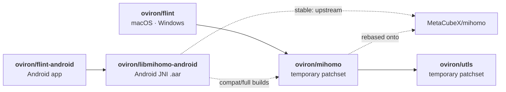

<div align="center">

# oviron/utls

**Temporary patchset on top of [MetaCubeX/utls](https://github.com/MetaCubeX/utls) and [refraction-networking/utls](https://github.com/refraction-networking/utls) carrying Firefox 158, Chrome 155, classical P-256 key-share handling, and a zstd DoS fix.**

**English** · [Русский](README.ru.md)

<p>
  <a href="https://github.com/oviron/utls/tags"></a>
  <a href="https://github.com/oviron/utls/actions/workflows/go.yml"></a>
  <a href="https://github.com/MetaCubeX/utls"></a>
  <a href="LICENSE"></a>
</p>

<p>
  <a href="#what-this-patchset-carries">Patch Matrix</a> ·
  <a href="#branches--usage">Branches &amp; Usage</a> ·
  <a href="#upstream-convergence-policy">Convergence Policy</a> ·
  <a href="#flint-ecosystem">Flint Ecosystem</a>
</p>

</div>

> [!IMPORTANT]
> **This is a temporary bridge fork, not a long-term uTLS replacement.**
> The Go module path intentionally stays `github.com/metacubex/utls` (consumed via `replace`) so it can be dropped cleanly as soon as upstream [refraction-networking/utls](https://github.com/refraction-networking/utls) and [MetaCubeX/utls](https://github.com/MetaCubeX/utls) ship these fixes in a release.

---

## What This Patchset Carries

Full technical notes live in [FORK.md](FORK.md). Current delta on top of `MetaCubeX/utls` (`v1.9.0-mod-meta`):

| Patch | Why it's needed now | Upstream status / reference |
| :--- | :--- | :--- |
| **`HelloFirefox_158` + 240 B GREASE ECH** | Matches current Firefox stable (NSS 3.127) field-by-field with `X25519MLKEM768` (`HelloFirefox_Auto` points here) | [refraction-networking/utls#427](https://github.com/refraction-networking/utls/pull/427) |
| **`HelloChrome_155`** | Backported from `refraction-networking/utls` `master` (`6ebdceb`) — default fingerprint of `Xray-core v26.11.9` (`HelloChrome_Auto` stays Chrome 133) | In `refraction-networking/utls` `master`, not yet in `MetaCubeX/utls` |
| **Keep every classical key share's private key** | Prevents handshake failure when a server selects P-256 instead of X25519 on multi-share parrots (e.g. `firefox120`, `firefox158`) | [refraction-networking/utls#433](https://github.com/refraction-networking/utls/pull/433) |
| **`klauspost/compress v1.20.4`** | Fixes a panic/crash in zstd certificate decompression on crafted streams (`GHSA-fpmh-frq8-7rj8`), relevant because Firefox 158 advertises zstd cert compression | Upstream still pins `v1.17.9` (bump raises `go` line to `1.25`) |

`HelloChrome_Auto` (Chrome 133) and `HelloFirefox_120` remain unchanged from the upstream base.

## Branches & Usage

| Branch | Upstream base | Consumer |
| :--- | :--- | :--- |
| **`oviron`** *(default)* | `MetaCubeX/utls` (`v1.9.0-mod-meta`) | [oviron/mihomo](https://github.com/oviron/mihomo) (`utls` / `compat` / `full`) |
| **`oviron-refraction`** | `refraction-networking/utls` | Consumers of upstream `refraction-networking/utls` |

Consume via `go.mod` `replace`:

```go
replace github.com/metacubex/utls => github.com/oviron/utls v1.9.0-oviron.4
```

For full uTLS API documentation, see [refraction-networking/utls](https://github.com/refraction-networking/utls) and [pkg.go.dev](https://pkg.go.dev/github.com/refraction-networking/utls).

## Upstream Convergence Policy

Tags follow `v<base>-oviron.<n>` (e.g. `v1.9.0-oviron.4`). Whenever `MetaCubeX/utls` cuts a new base tag, `oviron` is rebased onto it, `go test ./...` is verified, and every pick already merged upstream is dropped. Once all four items land upstream, this repository will be archived and `oviron/mihomo` will drop the `replace` line.

## Flint Ecosystem



| Repository | Role | Lifecycle |
| :--- | :--- | :--- |
| **[oviron/flint](https://github.com/oviron/flint)** | Native desktop client (macOS AppKit, Windows WPF) | Standalone app |
| **[oviron/flint-android](https://github.com/oviron/flint-android)** | Android client (Flutter + Kotlin Material 3) | Standalone app |
| **[oviron/libmihomo-android](https://github.com/oviron/libmihomo-android)** | Standalone Android JNI `.aar` library wrapping mihomo | Standalone library |
| **[oviron/mihomo](https://github.com/oviron/mihomo)** | Layered patchset on `MetaCubeX/mihomo` (`utls` / `compat` / `full`) | Temporary upstream bridge |
| **[oviron/utls](https://github.com/oviron/utls)** | Firefox 158, Chrome 155, P-256 key-share & zstd CVE fixes | Temporary upstream bridge |

## License

BSD-3-Clause, unchanged from upstream uTLS. See [LICENSE](LICENSE).
