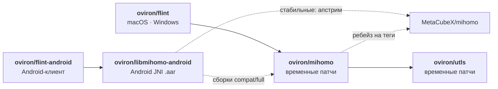

<div align="center">

# oviron/utls

**Временный набор патчей поверх [MetaCubeX/utls](https://github.com/MetaCubeX/utls) и [refraction-networking/utls](https://github.com/refraction-networking/utls): Firefox 158, Chrome 155, фикс классических P-256 key share и исправление CVE в zstd.**

[English](README.md) · **Русский**

<p>
  <a href="https://github.com/oviron/utls/tags"></a>
  <a href="https://github.com/oviron/utls/actions/workflows/go.yml"></a>
  <a href="https://github.com/MetaCubeX/utls"></a>
  <a href="LICENSE"></a>
</p>

<p>
  <a href="#что-содержит-этот-набор-патчей">Матрица патчей</a> ·
  <a href="#ветки-и-подключение">Ветки и подключение</a> ·
  <a href="#политика-возврата-к-апстриму">Политика возврата</a> ·
  <a href="#экосистема-flint">Экосистема Flint</a>
</p>

</div>

> [!IMPORTANT]
> **Это временный форк-мост, а не постоянная замена uTLS.**
> Путь Go-модуля намеренно оставлен `github.com/metacubex/utls` (подключается через `replace`), чтобы его можно было безболезненно убрать, как только [refraction-networking/utls](https://github.com/refraction-networking/utls) и [MetaCubeX/utls](https://github.com/MetaCubeX/utls) выпустят эти изменения в релизе.

---

## Что содержит этот набор патчей

Полные технические детали — в [FORK.md](FORK.md). Текущая дельта поверх `MetaCubeX/utls` (`v1.9.0-mod-meta`):

| Патч | Зачем нужен сейчас | Статус в апстриме |
| :--- | :--- | :--- |
| **`HelloFirefox_158` + 240 Б GREASE ECH** | Точно повторяет ClientHello актуального Firefox stable (NSS 3.127) с `X25519MLKEM768` (`HelloFirefox_Auto` указывает сюда) | [refraction-networking/utls#427](https://github.com/refraction-networking/utls/pull/427) |
| **`HelloChrome_155`** | Бэкпорт из `master` `refraction-networking/utls` (`6ebdceb`) — дефолтный отпечаток `Xray-core v26.11.9` (`HelloChrome_Auto` остаётся Chrome 133) | Есть в `master` `refraction-networking/utls`, но ещё не дошёл до `MetaCubeX/utls` |
| **Сохранение приватного ключа каждого классического key share** | Убирает срыв рукопожатия, когда сервер выбирает P-256 вместо X25519 у отпечатков с несколькими ключами (`firefox120`, `firefox158`) | [refraction-networking/utls#433](https://github.com/refraction-networking/utls/pull/433) |
| **`klauspost/compress v1.20.4`** | Закрывает панику/падение декодера zstd-сертификатов (`GHSA-fpmh-frq8-7rj8`), что важно для Firefox 158 | Апстрим пока на `v1.17.9` (обновление поднимает `go` до `1.25`) |

## Ветки и подключение

| Ветка | База апстрима | Потребитель |
| :--- | :--- | :--- |
| **`oviron`** *(по умолчанию)* | `MetaCubeX/utls` (`v1.9.0-mod-meta`) | [oviron/mihomo](https://github.com/oviron/mihomo/blob/compat/README.ru.md) (`utls` / `compat` / `full`) |
| **`oviron-refraction`** | `refraction-networking/utls` | Проекты на апстримном модуле `refraction-networking/utls` |

Подключение через `replace` в `go.mod`:

```go
replace github.com/metacubex/utls => github.com/oviron/utls v1.9.0-oviron.4
```

## Политика возврата к апстриму

Теги именуются как `v<base>-oviron.<n>` (например `v1.9.0-oviron.4`). При выходе нового тега в `MetaCubeX/utls` ветка `oviron` перебазируется на него, прогоняется `go test ./...`, а все уже принятые в апстриме коммиты удаляются. Когда все 4 правки попадут в апстрим, репозиторий будет заархивирован, а `replace` в `oviron/mihomo` — убран.

## Экосистема Flint



| Репозиторий | Роль | Статус |
| :--- | :--- | :--- |
| **[oviron/flint](https://github.com/oviron/flint/blob/main/README.ru.md)** | Нативный десктопный клиент (macOS AppKit, Windows WPF) | Самостоятельный продукт |
| **[oviron/flint-android](https://github.com/oviron/flint-android/blob/main/README.ru.md)** | Android-клиент (Flutter + Kotlin Material 3) | Самостоятельный продукт |
| **[oviron/libmihomo-android](https://github.com/oviron/libmihomo-android/blob/main/README.ru.md)** | Отдельная Android JNI-библиотека `.aar` поверх mihomo | Самостоятельная библиотека |
| **[oviron/mihomo](https://github.com/oviron/mihomo/blob/compat/README.ru.md)** | Слои патчей поверх `MetaCubeX/mihomo` (`utls` / `compat` / `full`) | Временный форк до апстрима |
| **[oviron/utls](https://github.com/oviron/utls/blob/oviron/README.ru.md)** | Firefox 158, Chrome 155, фикс P-256 key share и zstd CVE | Временный форк до апстрима |

## Лицензия

BSD-3-Clause, без изменений относительно апстрима uTLS. См. [LICENSE](LICENSE).
